<!-- Custom artwork lives in ./assets. Commit the README and assets together. -->
<picture>
  <source media="(max-width: 600px) and (prefers-reduced-motion: reduce)" srcset="./assets/hero-mobile-still.svg" />
  <source media="(prefers-reduced-motion: reduce)" srcset="./assets/hero-still.svg" />
  <source media="(max-width: 600px)" srcset="./assets/hero-mobile.svg" />
  
</picture>

<p align="center">
  <a href="https://fakhrul.codechronic.com/"></a>
  <a href="https://www.linkedin.com/in/md-fakhrul-alam-shuvo/"></a>
  <a href="https://profiles.wordpress.org/fakhrulalam16/"></a>
  <a href="mailto:fakhrul20.alam@gmail.com"></a>
</p>

I’m **Fakhrul**, a full-stack web developer in Dhaka. My projects include a public API for Bangladesh, a civic complaint portal, and an AI trip planner. I also build WordPress plugins and WooCommerce integrations for clients.

<picture>
  <source media="(max-width: 600px)" srcset="./assets/projects-mobile.svg" />
  
</picture>

### BDApi4All · Try a request

I built a public REST API for Bangladesh data. Open a route below for a sample result, or run it against the live API. On a cache miss, the Next.js district handler queries PostgreSQL through Prisma.

<details>
<summary><b>GET /districts</b> · Inspect response</summary>

<picture>
  <source media="(prefers-reduced-motion: reduce)" srcset="./assets/districts-still.svg" />
  
</picture>

[Run this request](https://bdapi4all.vercel.app/api/v1/districts) · [Read the route handler](https://github.com/fakhrul62/bdapi4all/blob/main/src/app/api/v1/districts/route.ts)

</details>

<details>
<summary><b>GET /divisions</b> · Inspect response</summary>

<picture>
  <source media="(prefers-reduced-motion: reduce)" srcset="./assets/divisions-still.svg" />
  
</picture>

[Run this request](https://bdapi4all.vercel.app/api/v1/divisions) · [Read the route handler](https://github.com/fakhrul62/bdapi4all/blob/main/src/app/api/v1/divisions/route.ts)

</details>

[Open the interactive API playground](https://bdapi4all.vercel.app/playground) · [Browse the source](https://github.com/fakhrul62/bdapi4all)

### CivicDesk · From complaint form to ticket

A citizen submits a complaint in the web app. A Next.js server action validates the form and creates a ticket in PostgreSQL through Prisma. Agents and supervisors can track it through review and resolution.

[Read the ticket actions](https://github.com/fakhrul62/civicdesk/blob/main/actions/tickets.ts) · [Explore the data model](https://github.com/fakhrul62/civicdesk/blob/main/prisma/schema.prisma)

### AI Travel Planner · From preferences to itinerary

I built a React and Next.js dashboard that turns travel preferences into a personalised itinerary using Gemini and MongoDB.

[Try the planner](https://travel-ai-dashboard-k3pt.vercel.app/) · [Browse the source](https://github.com/fakhrul62/travel-ai-dashboard)

<picture>
  <source media="(max-width: 600px)" srcset="./assets/stack-mobile.svg" />
  
</picture>

### Frontend & web applications

Responsive web development, with React and Next.js experience through personal projects.

      

### Backend & data

APIs, integrations, and database-backed applications across client work and personal projects.

    

### AI application projects

Hands-on exploration through projects such as an AI travel planner and Hungry Bangla AI. I use AI-assisted development with human review and validation.

   

### Newer additions

Growing familiarity through practice and personal projects.

   

### WordPress & website platforms

My client work covers custom plugins, structured content, e-commerce, and integrations. [Published WordPress plugins](https://profiles.wordpress.org/fakhrulalam16/) · [Apiro Free Icon Picker](https://free-awesome.vercel.app/)

     

### Design & delivery

   

**Also in my workflow:** responsive QA, debugging, performance optimisation, technical SEO, hosting/DNS, and client collaboration.

<details>
<summary><b>More tools I've worked with</b></summary>

Supabase, Firebase, Context API, plus foundational exposure to Shopify, Wix, and Odoo.

</details>

<picture>
  <source media="(max-width: 600px)" srcset="./assets/learning-mobile.svg" />
  
</picture>

I'm deepening my backend skills and exploring how AI integrations can make everyday software more useful.

| Training & education | Focus |
| :-- | :-- |
| **OpenAI** · 2026 | AI Foundations, Applied AI Foundations, Agents and Workflows |
| **Anthropic Education** · 2026 | Claude 101 |
| **Programming Hero** · 2024 | Complete Web Development |
| **BSc in Computer Science & Engineering** · 2025 | Prime University, Dhaka |

<picture>
  <source media="(max-width: 600px)" srcset="./assets/connect-mobile.svg" />
  
</picture>

Have a website to improve, an integration to untangle, or an idea worth building? I'm open to collaboration and open-source contributions.

**[Portfolio](https://fakhrul.codechronic.com/) · [LinkedIn](https://www.linkedin.com/in/md-fakhrul-alam-shuvo/) · [Email](mailto:fakhrul20.alam@gmail.com)**

```console
fakhrul@workspace:~$ make something useful
```
