<picture><source media="(max-width: 600px) and (prefers-reduced-motion: reduce)" srcset="./assets/fullstack-nestjs-mobile-still.svg" /><source media="(prefers-reduced-motion: reduce)" srcset="./assets/fullstack-nestjs-still.svg" /><source media="(max-width: 600px)" srcset="./assets/fullstack-nestjs-mobile.svg" /></picture>

  

<picture><source media="(max-width: 600px) and (prefers-reduced-motion: reduce)" srcset="./assets/folio-geo-mobile-still.svg" /><source media="(prefers-reduced-motion: reduce)" srcset="./assets/folio-geo-still.svg" /><source media="(max-width: 600px)" srcset="./assets/folio-geo-mobile.svg" /></picture>

<picture>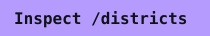</picture>

<picture><source media="(prefers-reduced-motion: reduce)" srcset="./assets/districts-still.svg" /></picture>

 

<picture></picture>

<picture><source media="(prefers-reduced-motion: reduce)" srcset="./assets/divisions-still.svg" /></picture>

 

 <a href="https://github.com/fakhrul62/bdapi4all">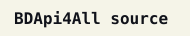</a>

<picture><source media="(max-width: 600px) and (prefers-reduced-motion: reduce)" srcset="./assets/folio-civic-mobile-still.svg" /><source media="(prefers-reduced-motion: reduce)" srcset="./assets/folio-civic-still.svg" /><source media="(max-width: 600px)" srcset="./assets/folio-civic-mobile.svg" /></picture>

 

<picture><source media="(max-width: 600px) and (prefers-reduced-motion: reduce)" srcset="./assets/folio-trip-mobile-still.svg" /><source media="(prefers-reduced-motion: reduce)" srcset="./assets/folio-trip-still.svg" /><source media="(max-width: 600px)" srcset="./assets/folio-trip-mobile.svg" /></picture>

 <a href="https://github.com/fakhrul62/travel-ai-dashboard">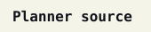</a>

<picture><source media="(max-width: 600px)" srcset="./assets/folio-skills-mobile.svg" />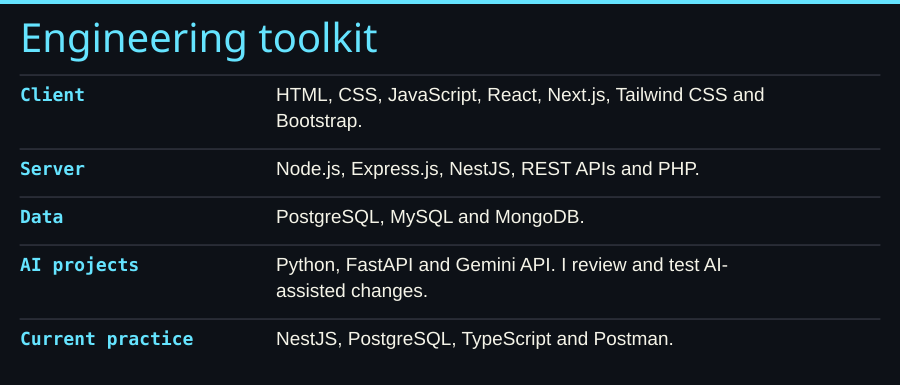</picture>

<picture>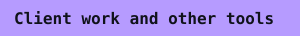</picture>

<picture><source media="(max-width: 600px)" srcset="./assets/folio-delivery-mobile.svg" />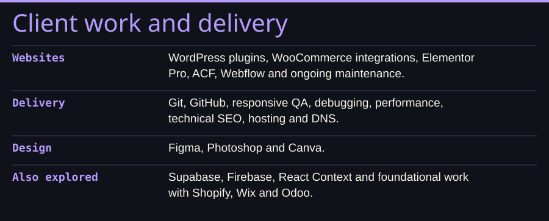</picture>

 

<picture></picture>

<picture><source media="(max-width: 600px)" srcset="./assets/folio-training-mobile.svg" />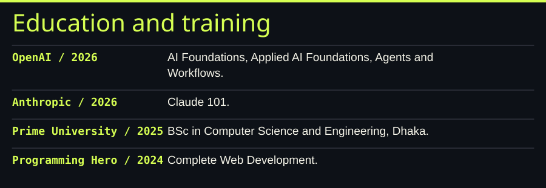</picture>

<picture><source media="(max-width: 600px)" srcset="./assets/folio-contact-mobile.svg" />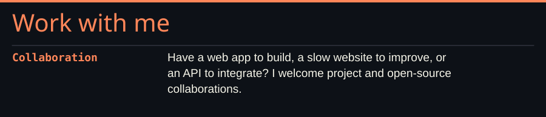</picture>

  

